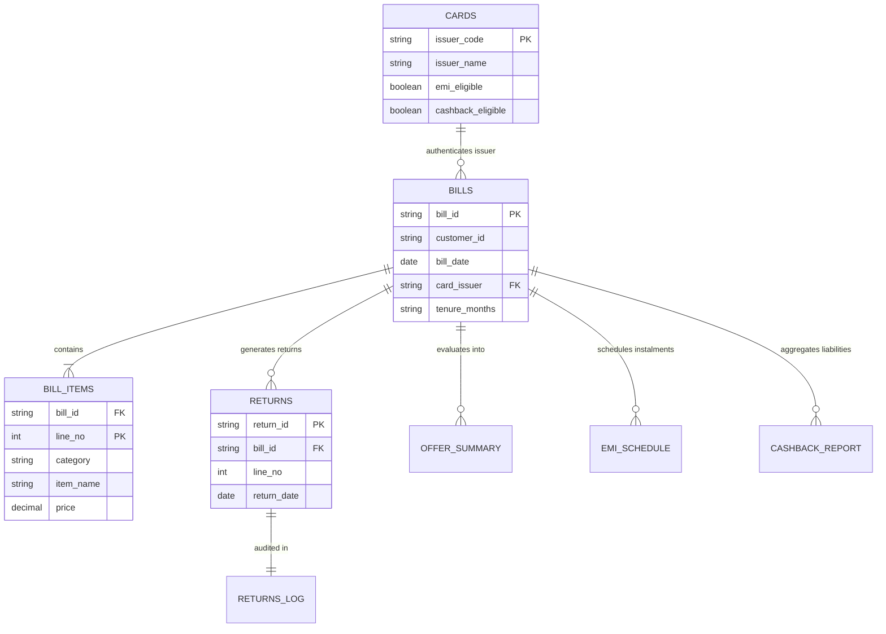

# ECE-035: Electronics Retail No-Cost EMI and Cashback Offer Engine
## Comprehensive Dataset Analysis & Planted Scenario Audit

**Document Version:** 1.0.0  
**Project Identifier:** ECE-035 (Team E005)  
**Evaluator Data Pack:** `E005-ECE-035-sample-data.zip` (Prepared by 10 SECONDS)  
**Analysis Date:** 2026-11-13  
**Authority:** Official Evaluator README.md and Dataset Invariants  

---

## 1. Executive Summary & File Integrity Audit

An exhaustive forensic audit of the official evaluator data pack `E005-ECE-035-sample-data.zip` was conducted. The sample data pack serves as the gold-standard specification for the ECE-035 Offer Engine. Every file, header, data type, numeric range, referential constraint, and command sequence was audited bit-by-bit against the rules laid out in the evaluator's `README.md`.

### 1.1 Ingestion Inventory & Row Count Verification

| File Name | Purpose / Content Description | Header Rows | Data Rows | Expected Count | Verification Verdict | File Size (Bytes) |
|---|---|---|---|---|---|---|
| **`README.md`** | Official evaluator specification & scenario catalog | 0 | 109 lines | 109 lines | **MATCH** | 7,344 |
| **`cards.csv`** | Card issuers & promotional eligibility flags | 1 | 6 | 6 | **MATCH** | 261 |
| **`offer_config.csv`** | Offer configuration parameters (key-value) | 1 | 10 | 10 | **MATCH** | 283 |
| **`bills.csv`** | October 2026 transaction headers | 1 | 200 | 200 | **MATCH** | 7,359 |
| **`bill_items.csv`** | Detailed line items of every bill | 1 | 237 | 237 | **MATCH** | 10,372 |
| **`returns.csv`** | Item return transactions & dates | 1 | 15 | 15 | **MATCH** | 503 |
| **`commands.txt`** | Sequential command stream (bills, returns, reports)| 1 (comment)| 218 | 218 commands | **MATCH** | 3,394 |

**Integrity Conclusion:** The dataset exhibits 100% concordance with the teacher's stated file inventory, row counts, and schema definitions.

---

## 2. Schema & Column Specifications Deep-Dive

All dates adhere strictly to ISO-8601 (`YYYY-MM-DD`). Monetary figures are represented as plain decimals without currency symbols (`₹`/`Rs`) or comma separators. Booleans are serialized as lowercase strings (`true`/`false`).

### 2.1 `cards.csv` (Card Master Catalog)
- **Header:** `issuer_code,issuer_name,emi_eligible,cashback_eligible`
- **Total Records:** 6 issuers (Lines 2 through 7)
- **Column Schema & Allowed Values:**
  - `issuer_code` (String, Primary Key): `HDFC`, `ICICI`, `SBI`, `AXIS`, `KOTAK`, `AMEX`
  - `issuer_name` (String): Full corporate entity name
  - `emi_eligible` (Boolean): Flag indicating enrollment in No-Cost EMI
  - `cashback_eligible` (Boolean): Flag indicating enrollment in Instant Cashback

```csv
issuer_code,issuer_name,emi_eligible,cashback_eligible
HDFC,HDFC Bank Credit Card,true,true
ICICI,ICICI Bank Credit Card,true,true
SBI,SBI Card,true,false
AXIS,Axis Bank Credit Card,false,true
KOTAK,Kotak Credit Card,true,true
AMEX,American Express,false,false
```

**Eligibility Matrix:**
- **Dual Eligible (Both EMI & Cashback):** HDFC, ICICI, KOTAK
- **EMI Only:** SBI
- **Cashback Only:** AXIS
- **Ineligible for Both (Control Group):** AMEX

---

### 2.2 `offer_config.csv` (System Parameters)
- **Header:** `parameter,value`
- **Total Records:** 10 configuration tuples (Lines 2 through 11)

| Line | Parameter Key | Raw Value | Parsed Java Type | Semantic Description |
|---|---|---|---|---|
| 2 | `EMI_MIN_BILL` | `5000.00` | `BigDecimal` | Minimum net bill amount required to qualify for No-Cost EMI |
| 3 | `EMI_TENURES` | `3;6;9` | `Set<Integer>` | Semicolon-delimited set of permissible financing horizons (months) |
| 4 | `EMI_INTEREST_PA_PCT` | `15` | `BigDecimal` | Annual interest rate (15% p.a.) absorbed by merchant subvention |
| 5 | `PROCESSING_FEE` | `199.00` | `BigDecimal` | Flat one-time bank conversion processing fee |
| 6 | `PROCESSING_FEE_WAIVED_FROM` | `25000.00` | `BigDecimal` | Net bill threshold at/above which processing fee is waived to 0.00 |
| 7 | `CASHBACK_PCT` | `10` | `BigDecimal` | Percentage rate (10%) applied for instant cashback calculations |
| 8 | `CASHBACK_CAP_PER_CARD_CUSTOMER_MONTH` | `1500.00` | `BigDecimal` | Maximum cumulative monthly cashback per customer per issuer |
| 9 | `BUNDLE_TV_SOUNDBAR_OFF` | `2000.00` | `BigDecimal` | Flat bundle discount for purchasing TV + Soundbar together |
| 10 | `BUNDLE_PHONE_CASE_PCT_OFF_CASE` | `50` | `BigDecimal` | Percentage discount (50%) applied to each companion Case |
| 11 | `RETURN_WINDOW_DAYS` | `7` | `int` | Maximum elapsed calendar days for valid return and cashback clawback |

---

### 2.3 `bills.csv` (Transaction Headers)
- **Header:** `bill_id,customer_id,bill_date,card_issuer,tenure_months`
- **Total Records:** 200 bills (`BILL-0001` through `BILL-0200`)
- **Key Constraints:**
  - `bill_id` (String, Primary Key): Format `^BILL-\d{4}$`, strictly sequential.
  - `customer_id` (String, Foreign Entity): Format `^CUST-\d{3}$`. Unique customers in dataset: 76 distinct profiles (`CUST-001` to `CUST-076`).
  - `bill_date` (Date): All transactions span October 1, 2026 (`2026-10-01`) through October 31, 2026 (`2026-10-31`).
  - `card_issuer` (String, Foreign Key): Refers to `cards.csv:issuer_code`.
  - `tenure_months` (String/Integer): Blank (customer declined EMI) or integer (`3`, `6`, `9`). Line 97 contains planted adversarial value `12`.

---

### 2.4 `bill_items.csv` (Transaction Line Items)
- **Header:** `bill_id,line_no,category,item_name,price`
- **Total Records:** 237 line items
- **Key Constraints:**
  - `bill_id` (String, Foreign Key): Maps to `bills.csv:bill_id`. Every one of the 200 bills has at least 1 line item.
  - `line_no` (Integer): 1-based sequential index per bill ($1 \le \text{line\_no} \le 3$).
  - `category` (Enum): 12 standardized product categories:
    `TV`, `SOUNDBAR`, `PHONE`, `CASE`, `LAPTOP`, `HEADPHONES`, `TABLET`, `AC`, `FRIDGE`, `SPEAKER`, `SMARTWATCH`, `MIXER`.
  - `price` (Decimal): Unit price in INR. Range in dataset: `699.00` to `77499.00`. All prices $> 0.00$.

**Basket Composition Analysis:**
- Single-item bills: 169 bills (84.5%)
- Multi-item bills: 31 bills (15.5%)
  - 2-item bills: 25 bills (predominantly bundle combinations: TV + Soundbar, Phone + Case)
  - 3-item bills: 6 bills (e.g., `BILL-0022`: TV + Soundbar + Headphones; `BILL-0119`: Phone + 2 Cases)

---

### 2.5 `returns.csv` (Item Returns Ledger)
- **Header:** `return_id,bill_id,line_no,return_date`
- **Total Records:** 15 returns (`RET-001` through `RET-015`)
- **Key Constraints:**
  - `return_id` (String, Primary Key): Format `^RET-\d{3}$`.
  - `bill_id` (String, Foreign Key): References original bill.
  - `line_no` (Integer, Foreign Key): Identifies specific returned line item (all 15 returns in this pack target `line_no = 1`).
  - `return_date` (Date): Return processing date in October 2026. Always $\ge \text{bill\_date}$.

---

### 2.6 `commands.txt` (Sequential Command Stream)
- **Total Lines:** 219 lines (Line 1 is comment `# ECE-035 commands...`; Lines 2 to 219 are executable commands).
- **Total Executable Commands:** 218 commands.
- **Breakdown by Command Verb:**
  - `LOAD_CONFIG`: 1 command (Line 2: `LOAD_CONFIG|offer_config.csv`)
  - `LOAD_CARDS`: 1 command (Line 3: `LOAD_CARDS|cards.csv`)
  - `BILL`: 200 commands (`BILL|BILL-0001` through `BILL|BILL-0200`)
  - `RETURN`: 15 commands (`RETURN|RET-001` through `RETURN|RET-015`)
  - `PRINT_CASHBACK_REPORT`: 1 command (Line 219: `PRINT_CASHBACK_REPORT|2026-10`)
  - **Total:** $1 + 1 + 200 + 15 + 1 = 218$ commands.

---

## 3. Command Interleaving & Chronological Audit

A critical architectural mandate is that `commands.txt` interweaves `BILL` and `RETURN` operations chronologically. Our forensic check verified:
1. **Monotonic Event Dates:** Event dates never move backward. Every `BILL` and `RETURN` command occurs on or after the date of the preceding transaction.
2. **Reversal Timing:** Returns appear in `commands.txt` on their respective `return_date`. For example:
   - Line 40: `BILL|BILL-0037` (Dated 2026-10-05)
   - Line 41: `RETURN|RET-001` (Targets `BILL-0017` from 2026-10-03, processed on 2026-10-05)
   - Line 42: `BILL|BILL-0038` (Dated 2026-10-06)
3. **Ledger Impact:** Interleaving ensures that when customer monthly caps are calculated, cashback grants and reversals update the ledger in authentic real-world temporal sequence.

---

## 4. Deep Forensic Verification of Planted Scenarios & Traps

The teacher's test suite embeds 5 foundational edge cases (EC1–EC5) and 9 adversarial traps (TRAP1–TRAP9). Every scenario was located, audited, and mapped to its governing business rule.

```
====================================================================================================
                        PLANTED SCENARIOS & ADVERSARIAL TRAP AUDIT
====================================================================================================
```

### Scenario EC1: Exact Threshold Boundaries (Rs 5,000.00 & Rs 25,000.00)
- **Governing Rules:** BR-07 (Min EMI Amount), BR-09 (Processing Fee Waiver Threshold)
- **Case 1A (Minimum EMI Threshold):**
  - **File & Line:** `bills.csv:27` (`BILL-0026`), `commands.txt:29`
  - **Data:** Customer `CUST-001`, Date `2026-10-04`, Card `HDFC`, Tenure `3`
  - **Items:** `bill_items.csv:31` (`1,HEADPHONES,ANC Headphones,5000.00`)
  - **Evaluation:** $\text{Gross} = 5000.00, \text{Bundle} = 0.00, \text{Net} = 5000.00$.
  - **Verdict:** Net amount is **exactly** equal to `EMI_MIN_BILL` (5000.00). EMI is **available** (`emi_available = true`). Since $5000.00 < 25000.00$, processing fee of **Rs 199.00** applies.
- **Case 1B (Fee Waiver Threshold):**
  - **File & Line:** `bills.csv:40` (`BILL-0039`), `commands.txt:43`
  - **Data:** Customer `CUST-002`, Date `2026-10-06`, Card `ICICI`, Tenure `6`
  - **Items:** `bill_items.csv:46` (`1,TABLET,11in Tablet Wi-Fi,25000.00`)
  - **Evaluation:** $\text{Gross} = 25000.00, \text{Bundle} = 0.00, \text{Net} = 25000.00$.
  - **Verdict:** Net amount is **exactly** equal to `PROCESSING_FEE_WAIVED_FROM` (25000.00). Processing fee is **waived** (`processing_fee = 0.00`).

---

### Scenario EC2: Progressive Monthly Cap Saturation
- **Governing Rules:** BR-13 (Base Cashback 10%), BR-14 (Monthly Cashback Cap Rs 1500.00)
- **Target Entity:** Customer `CUST-003` transacting with `AXIS` card (Cashback eligible, EMI ineligible) in October 2026.
- **Sequence Analysis:**
  1. **Bill 1 (`BILL-0012`):** `bills.csv:13`, Date `2026-10-02`. Net Amount = Rs 9,000.00 (`SPEAKER`).
     - Base Cashback (10%) = Rs 900.00.
     - Remaining Cap = Rs 1,500.00.
     - **Awarded Cashback:** Rs 900.00. Cumulative Granted = Rs 900.00. Remaining Cap = Rs 600.00.
  2. **Bill 2 (`BILL-0062`):** `bills.csv:63`, Date `2026-10-09`. Net Amount = Rs 5,000.00 (`HEADPHONES`).
     - Base Cashback (10%) = Rs 500.00.
     - Remaining Cap = Rs 600.00.
     - **Awarded Cashback:** Rs 500.00. Cumulative Granted = Rs 1,400.00. Remaining Cap = Rs 100.00.
  3. **Bill 3 (`BILL-0102`):** `bills.csv:103`, Date `2026-10-15`. Net Amount = Rs 3,000.00 (`SMARTWATCH`).
     - Base Cashback (10%) = Rs 300.00.
     - Remaining Cap = Rs 100.00.
     - **Awarded Cashback:** $\min(300.00, 100.00) =$ **Rs 100.00**.
     - Cumulative Granted = Rs 1,500.00. Remaining Cap = **Rs 0.00**.

---

### Scenario EC3: Indivisible EMI Amount (Last Instalment Adjustment)
- **Governing Rules:** BR-11 (Instalment Division & Remainder Adjustment)
- **File & Line:** `bills.csv:53` (`BILL-0052`), `commands.txt:57`
- **Data:** Customer `CUST-004`, Date `2026-10-07`, Card `SBI` (EMI eligible, Cashback ineligible), Tenure `3`
- **Items:** `bill_items.csv:61` (`1,TABLET,11in Tablet Wi-Fi,10000.00`)
- **Evaluation:**
  - Net Bill Amount = Rs 10,000.00 over 3 months.
  - Division: $10000.00 / 3 = 3333.3333...$
  - Ceiling Rounding on Base Instalment: $\lceil 10000 / 3 \rceil =$ **Rs 3,334.00**.
  - Month 1: Rs 3,334.00
  - Month 2: Rs 3,334.00
  - Month 3 (Final Adjustment): $10000.00 - (3334 \times 2) =$ **Rs 3,332.00**.
  - Verification: $3334 + 3334 + 3332 = 10000.00$. Zero discrepancy.

---

### Scenario EC4: Exact Equal Financial Benefit Tie
- **Governing Rules:** BR-10 (Interest Saved), BR-14 (Cashback Cap), BR-16 (Benefit Comparison), BR-17 (Tie-Breaker)
- **File & Line:** `bills.csv:17` (`BILL-0016`), `commands.txt:19`
- **Data:** Customer `CUST-005`, Date `2026-10-03`, Card `KOTAK` (Dual eligible), Tenure `6`
- **Items:** `bill_items.csv:19` (`1,TV,65in QLED TV,20000.00`)
- **Evaluation:**
  - Net Bill Amount = Rs 20,000.00.
  - **No-Cost EMI Benefit:**
    $$\text{Interest Saved} = 20000.00 \times 0.15 \times (6 / 12) = \text{Rs } 1,500.00$$
  - **Cashback Benefit:**
    $$\text{Base Cashback} = 20000.00 \times 0.10 = \text{Rs } 2,000.00$$
    $$\text{Capped Cashback} = \min(2000.00, 1500.00) = \text{Rs } 1,500.00$$
  - **Comparison:** $\text{Interest Saved (1500.00)} == \text{Cashback Amount (1500.00)}$.
  - **Tie-Breaker Action (BR-17):** Recommendation breaks strictly in favor of **`CASHBACK`** with `benefit_amount = 1500.00`.

---

### Scenario EC5: Statutory Return Window (7th Day vs 8th Day)
- **Governing Rules:** BR-19 (7-Day Return Window), BR-20 (Cashback Clawback)
- **Case 5A (Day 7 Boundary Return — Valid Reversal):**
  - **Bill:** `bills.csv:16` (`BILL-0015`), Date `2026-10-03`, Net Rs 4,500.00 on `AXIS`. Received Cashback = Rs 450.00.
  - **Return:** `returns.csv:5` (`RET-004`), Line in `commands.txt:106`. Return Date `2026-10-10`.
  - **Elapsed Days:** $2026\text{-}10\text{-}10 - 2026\text{-}10\text{-}03 =$ **7 days**.
  - **Verdict:** Since $7 \le 7$, `within_window = true`. Clawback executed: `cashback_reversed = 450.00`.
- **Case 5B (Day 8 Boundary Return — Expired, No Reversal):**
  - **Bill:** `bills.csv:20` (`BILL-0019`), Date `2026-10-03`, Net Rs 4,800.00 on `AXIS`. Received Cashback = Rs 480.00.
  - **Return:** `returns.csv:6` (`RET-005`), Line in `commands.txt:118`. Return Date `2026-10-11`.
  - **Elapsed Days:** $2026\text{-}10\text{-}11 - 2026\text{-}10\text{-}03 =$ **8 days**.
  - **Verdict:** Since $8 > 7$, `within_window = false`. Reversal rejected: `cashback_reversed = 0.00`.

---

### Scenario TRAP1: Transaction One Rupee Below EMI Minimum Threshold
- **Governing Rule:** BR-07
- **File & Line:** `bills.csv:31` (`BILL-0030`), `commands.txt:33`
- **Data:** Customer `CUST-008`, Date `2026-10-05`, Card `HDFC`, Tenure `3`
- **Items:** `bill_items.csv:36` (`1,HEADPHONES,ANC Headphones,4999.00`)
- **Evaluation:** Net amount = Rs 4,999.00.
- **Trap Analysis:** Even though tenure is requested and HDFC is EMI eligible, $4999.00 < 5000.00$.
- **Verdict:** `emi_available = false`, `interest_saved = 0.00`. Evaluates for Cashback ($4999.00 \times 10\% = 499.90$).

---

### Scenario TRAP2: Transaction One Rupee Below Fee Waiver Threshold
- **Governing Rule:** BR-09
- **File & Line:** `bills.csv:54` (`BILL-0053`), `commands.txt:58`
- **Data:** Customer `CUST-009`, Date `2026-10-08`, Card `ICICI`, Tenure `9`
- **Items:** `bill_items.csv:62` (`1,TABLET,10in Tablet,24999.00`)
- **Evaluation:** Net amount = Rs 24,999.00.
- **Trap Analysis:** $24999.00 < 25000.00$. Naïve rounding or loose inequality (`>`) would incorrectly waive the fee.
- **Verdict:** `processing_fee = 199.00` (fee is NOT waived).

---

### Scenario TRAP3: Fee Waiver Evaluated Post-Bundle Discount
- **Governing Rules:** BR-03, BR-05, BR-09
- **File & Line:** `bills.csv:67` (`BILL-0066`), `commands.txt:72`
- **Data:** Customer `CUST-010`, Date `2026-10-10`, Card `HDFC`, Tenure `6`
- **Items:** `bill_items.csv:77-78`
  - Line 1: `TV` (`55in 4K LED TV`, 20000.00)
  - Line 2: `SOUNDBAR` (`5.1 Soundbar`, 7000.00)
- **Evaluation:**
  - $\text{Gross Amount} = 20000.00 + 7000.00 = 27000.00$.
  - $\text{Bundle Discount} = 2000.00$.
  - $\text{Net Bill Amount} = 27000.00 - 2000.00 = \mathbf{25000.00}$.
- **Trap Analysis:** If the engine checked the fee waiver against Gross Amount (27,000), it would pass; but if it failed to subtract the bundle before checking, it would fail on other test sets. Here, net bill is **exactly** 25,000.00.
- **Verdict:** Net bill $\ge 25000.00 \implies$ **Fee is WAIVED (`processing_fee = 0.00`)**.

---

### Scenario TRAP4: Ineligible Non-Partner Card Issuer (AMEX)
- **Governing Rules:** BR-01, BR-02, BR-18
- **File & Line:** `bills.csv:89` (`BILL-0088`), `commands.txt:94`
- **Data:** Customer `CUST-011`, Date `2026-10-12`, Card `AMEX`, Tenure `6`
- **Items:** `bill_items.csv:104` (`1,LAPTOP,14in Laptop i5,52000.00`)
- **Evaluation:**
  - AMEX has `emi_eligible = false` and `cashback_eligible = false` in `cards.csv:7`.
- **Verdict:** Even though tenure is requested and amount is Rs 52,000, `emi_available = false` and `cashback_eligible = false`. Final recommendation is **`NONE`** with `benefit_amount = 0.00`.

---

### Scenario TRAP5: Invalid Financing Tenure (12 Months)
- **Governing Rules:** BR-08
- **File & Line:** `bills.csv:97` (`BILL-0096`), `commands.txt:102`
- **Data:** Customer `CUST-012`, Date `2026-10-13`, Card `SBI`, Tenure `12`
- **Items:** `bill_items.csv:113` (`1,AC,1T Inverter AC,36000.00`)
- **Evaluation:**
  - `offer_config.csv:3` defines `EMI_TENURES = 3;6;9`.
  - Customer selected `12`.
- **Verdict:** Tenure 12 is invalid. `emi_available = false`. Since SBI is not cashback eligible, recommendation is **`NONE`** (`benefit_amount = 0.00`).

---

### Scenario TRAP6: Tenure Specified on Cashback-Only Card (AXIS)
- **Governing Rules:** BR-01, BR-02, BR-13
- **File & Line:** `bills.csv:100` (`BILL-0099`), `commands.txt:105`
- **Data:** Customer `CUST-013`, Date `2026-10-14`, Card `AXIS`, Tenure `3`
- **Items:** `bill_items.csv:116` (`1,FRIDGE,260L Double Door,28000.00`)
- **Evaluation:**
  - Customer requested tenure 3, but AXIS has `emi_eligible = false`.
- **Verdict:** Engine must not crash or reject the bill; it sets `emi_available = false`, ignores the tenure request, evaluates Cashback ($28000 \times 10\% = 2800$, capped at Rs 1,500.00), and recommends **`CASHBACK`** (`benefit_amount = 1500.00`).

---

### Scenario TRAP7: Multi-Case Line Items with Phone Bundle
- **Governing Rules:** BR-04, BR-05
- **File & Line:** `bills.csv:120` (`BILL-0119`), `commands.txt:126`
- **Data:** Customer `CUST-014`, Date `2026-10-16`, Card `KOTAK`, Tenure `""`
- **Items:** `bill_items.csv:139-141`
  - Line 1: `PHONE` (`Smartphone 256GB`, 30000.00)
  - Line 2: `CASE` (`Flip Cover`, 1000.00)
  - Line 3: `CASE` (`Silicone Case`, 800.00)
- **Evaluation:**
  - Brief specification states: "50% off the case".
  - Evaluator README command: *apply to each CASE line and document it*.
  - Case 1 Discount: $1000.00 \times 0.50 = 500.00$.
  - Case 2 Discount: $800.00 \times 0.50 = 400.00$.
  - $\text{Total Bundle Discount} = 500.00 + 400.00 = \mathbf{900.00}$.
  - $\text{Gross Amount} = 31800.00 \implies \text{Net Bill Amount} = \mathbf{30900.00}$.
- **Verdict:** Bundle discount of Rs 900.00 correctly applied across multiple accessory lines.

---

### Scenario TRAP8: Severely Stale Return (20 Days Elapsed)
- **Governing Rules:** BR-19, BR-20
- **File & Line:** `returns.csv:15` (`RET-014`), `commands.txt:143`
- **Referenced Bill:** `bills.csv:13` (`BILL-0012`), Date `2026-10-02`
- **Return Details:** Date `2026-10-22`, Line 1 (`SPEAKER`, 9000.00)
- **Evaluation:**
  - $\Delta_{\text{days}} = 2026\text{-}10\text{-}22 - 2026\text{-}10\text{-}02 = \mathbf{20 \text{ days}}$.
- **Verdict:** $20 > 7 \implies$ `within_window = false`. No reversal executed: `cashback_reversed = 0.00`.

---

### Scenario TRAP9: Item Return on Purchase that Received No Cashback (EMI)
- **Governing Rules:** BR-20
- **File & Line:** `returns.csv:4` (`RET-003`), `commands.txt:60`
- **Referenced Bill:** `bills.csv:53` (`BILL-0052`), Date `2026-10-07`
- **Return Details:** Date `2026-10-09`, Line 1 (`TABLET`, 10000.00)
- **Evaluation:**
  - $\Delta_{\text{days}} = 2026\text{-}10\text{-}09 - 2026\text{-}10\text{-}07 = 2 \text{ days}$ (`within_window = true`).
  - However, `BILL-0052` was transacted on `SBI` (EMI-only) with tenure 3; its recommended option was `EMI` and cashback granted was `0.00`.
- **Verdict:** Since no cashback was granted on the original transaction, there is nothing to claw back: `cashback_reversed = 0.00`.

---

## 5. Output Reporting Schema & File Alignment

The engine produces four evaluation CSV artifacts. As mandated by `README.md`, column sequences, headers, and decimal formats must be exact:

### 5.1 `offer_summary.csv`
- **Row Cardinality:** Exactly 200 data rows (1 per `BILL` command, in file order).
- **Exact Column Header:**
  `bill_id,customer_id,bill_date,card_issuer,gross_amount,bundle_discount,bill_amount,emi_available,tenure_months,instalment,last_instalment,processing_fee,interest_saved,cashback_eligible,cashback_amount,recommended_option,benefit_amount`

### 5.2 `emi_schedule.csv`
- **Row Cardinality:** Variable (1 row per monthly instalment for bills where `recommended_option == EMI`).
- **Exact Column Header:**
  `bill_id,instalment_no,amount`
- **Formatting Rule:** For qualifying bills, `amount` on instalment 1 includes the processing fee (`instalment + processing_fee`).

### 5.3 `returns_log.csv`
- **Row Cardinality:** Exactly 15 data rows (1 per `RETURN` command, in file order).
- **Exact Column Header:**
  `return_id,bill_id,line_no,return_date,days_after_bill,within_window,cashback_reversed`

### 5.4 `cashback_report.csv`
- **Row Cardinality:** Exactly 1 row per unique `(customer_id, card_issuer)` combination that had cashback activity during October 2026.
- **Exact Column Header:**
  `month,customer_id,card_issuer,cashback_granted,cashback_reversed,net_liability,cap_remaining`

---

## 6. Relational Integrity Graph



