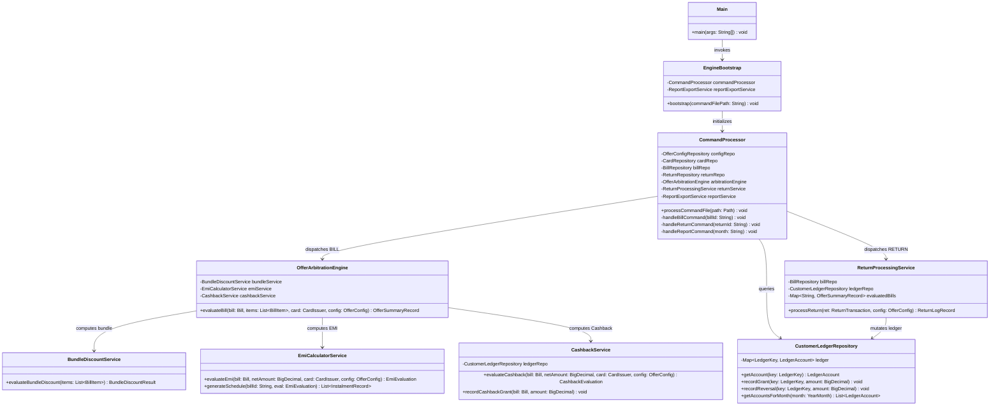
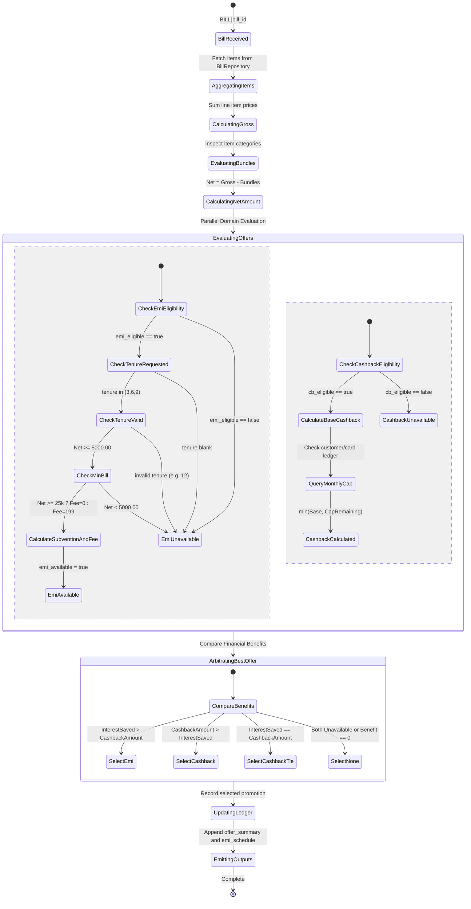
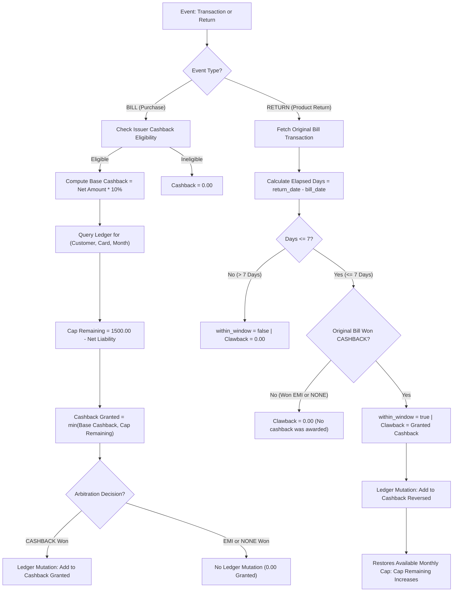
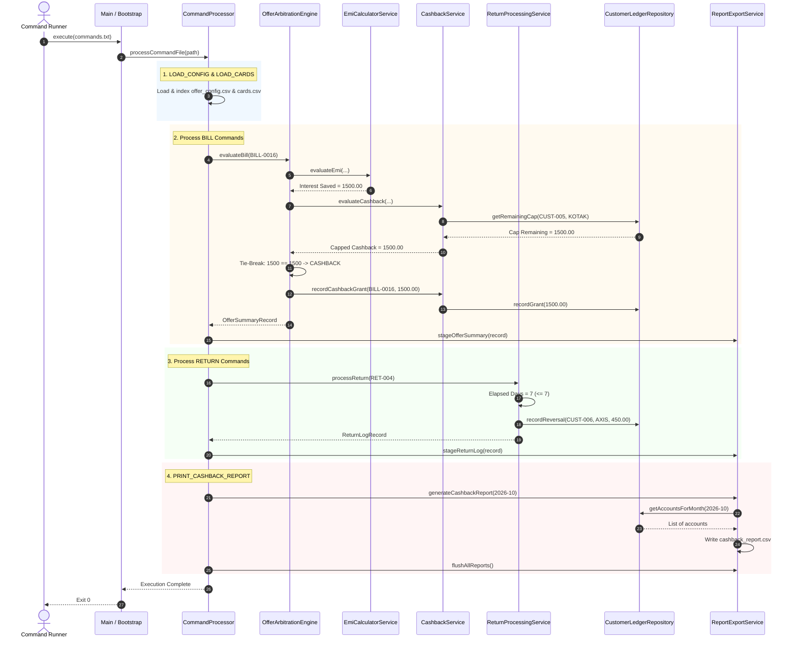
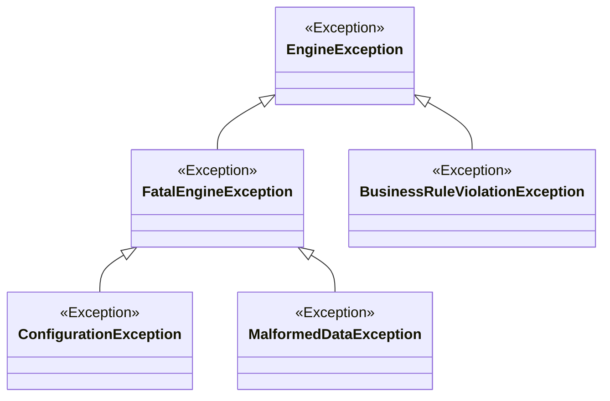

# ECE-035: Electronics Retail No-Cost EMI and Cashback Offer Engine
## Comprehensive Software Architecture & System Design Document (SDD)

**Document Version:** 1.0.0  
**Project Identifier:** ECE-035 (Team E005)  
**Standard:** IEEE 1016-2009 (Software Design Descriptions)  
**Target Platform:** Java 17+ SE (LTS), Headless Command-Line Interface (CLI)  
**Execution Paradigm:** Pure Deterministic In-Memory Stream Processing (Zero External Dependencies, Zero RDBMS, Zero Web/GUI)  
**Primary Authorities:** Official Evaluator Data Pack (`E005-ECE-035-sample-data.zip`), `README.md`, `REQUIREMENTS.md`, `DATASET_ANALYSIS.md`  

---

## 1. Project Overview, Scope & Glossary

### 1.1 Project Overview
The **ECE-035 Offer Engine** is a deterministic, high-throughput retail financial calculation engine developed in pure Java 17+. At consumer electronics points of sale (POS), customers purchasing high-value merchandise are presented with competitive promotional incentives sponsored by partner financial institutions (card issuers). These incentives fall into two mutually exclusive regimes:
1. **No-Cost EMI (Equated Monthly Instalment):** The retailer/manufacturer absorbs the customer's loan interest liability (interest subvention) at 15% per annum across standard tenures (3, 6, or 9 months), subject to transaction thresholds ($\ge \text{Rs } 5,000.00$) and administrative processing fee rules ($\text{Rs } 199.00$, waived at $\ge \text{Rs } 25,000.00$).
2. **Instant Card Cashback:** An upfront price reduction (10%) credited to the transaction, bounded by a strict monthly ceiling ($\text{Rs } 1,500.00$ per customer per card issuer per calendar month).

Because co-sponsoring bank agreements strictly forbid offer stacking, the engine acts as an automated fiduciary arbitration system, evaluating eligible options, determining exact consumer savings, executing tie-breaking protocols, managing item returns and cashback clawbacks, and outputting auditable reconciliation ledgers.

### 1.2 System Scope
- **In-Scope:**
  - Robust parsing of CSV data feeds (`cards.csv`, `offer_config.csv`, `bills.csv`, `bill_items.csv`, `returns.csv`).
  - Sequential processing of transactional command scripts (`commands.txt`).
  - Item bundle detection and discount computation (TV + Soundbar flat Rs 2,000 off, Phone + Case 50% off companion cases).
  - Net bill amount derivation as the baseline for all subsequent calculations.
  - No-Cost EMI interest subvention, equal instalment rounding, last instalment remainder absorption, and processing fee waiver evaluation.
  - Instant cashback calculation with rolling monthly cap saturation per customer per card.
  - Fiduciary offer arbitration: maximizing financial benefit with deterministic tie-breaking favoring Cashback.
  - Return window enforcement (7 calendar days) and conditional cashback clawback.
  - Generation of four standardized evaluation CSV files (`offer_summary.csv`, `emi_schedule.csv`, `returns_log.csv`, `cashback_report.csv`).
- **Out-of-Scope (Strict Constraints):**
  - No graphical user interface (GUI), web controllers, or REST endpoints.
  - No relational database (RDBMS), NoSQL, or disk-backed cache.
  - No third-party framework dependencies (Spring Boot, Hibernate, Apache Commons, Jackson, Lombok).
  - All processing is in-memory using standard Java collections and Java 17 language features.

### 1.3 Technical Glossary

| Term | Formal Engineering Definition |
|---|---|
| **No-Cost EMI** | A consumer financing structure where the customer pays only the purchase price in equated instalments; the lender's interest charge is subsidized upfront by the merchant/manufacturer. |
| **Interest Subvention** | The monetary value of interest absorbed by the retailer, computed as $\text{Principal} \times (\text{Rate} / 100) \times (\text{Tenure} / 12)$. In this system, it represents the customer's EMI benefit. |
| **Gross Amount** | The unadjusted sum of gross catalog prices for all line items belonging to a bill. |
| **Bundle Discount** | Price reductions granted when complementary products are purchased together in a single transaction. |
| **Net Bill Amount** | The definitive valuation baseline: $\text{Gross Amount} - \text{Bundle Discount}$. All fee waivers, minimum thresholds, interest subventions, and cashback percentages evaluate against this net figure. |
| **Mutual Exclusivity** | Legal constraint preventing a transaction from receiving both interest subvention (EMI) and cashback. |
| **Cashback Cap** | A rolling constraint limiting cumulative cashback grants to Rs 1,500.00 per customer, per card issuer, per calendar month. |
| **Clawback (Reversal)** | The operational cancellation of promotional cashback previously awarded when merchandise is returned within the statutory window. |
| **Statutory Window** | The maximum elapsed duration ($\le 7\text{ calendar days}$) between bill date and return date during which a return is legally eligible for cashback clawback. |
| **Deterministic Tie-Breaker** | The predefined policy selecting `CASHBACK` when both No-Cost EMI and Cashback yield identical monetary savings. |

---

## 2. Business Rules Register (BR-01 through BR-21)

Every component of the architecture directly satisfies one or more formal business rules:

```
+-------------------------------------------------------------------------------------------------------+
|                                  BUSINESS RULES REGISTER (BR-01 TO BR-21)                             |
+-------+-------------------------+---------------------------------------------------------------------+
| ID    | Domain / Title          | Formal Rule Statement & Formula                                     |
+-------+-------------------------+---------------------------------------------------------------------+
| BR-01 | Card EMI Eligibility    | EMI is restricted to cards where cards.csv emi_eligible == true.   |
| BR-02 | Card Cashback Elig.     | Cashback is restricted to cards where cards.csv cb_eligible == true |
| BR-03 | Bundle: TV + Soundbar   | Flat Rs 2,000.00 off per bill containing TV and SOUNDBAR categories. |
| BR-04 | Bundle: Phone + Case    | 50% off each CASE line item in bills containing PHONE category.     |
| BR-05 | Net Bill Derivation     | Bill Amount = Gross Amount - Bundle Discount.                       |
| BR-06 | Customer EMI Intent     | If tenure_months in bills.csv is blank, emi_available = false.      |
| BR-07 | Minimum EMI Threshold   | EMI requires Net Bill Amount >= Rs 5,000.00 (EMI_MIN_BILL).         |
| BR-08 | Permissible Tenures     | Allowed tenures: 3, 6, 9 months (from offer_config.csv).            |
| BR-09 | Processing Fee & Waiver | Fee = Rs 199.00 if Net < Rs 25,000.00; Waived (0.00) if Net >= 25k. |
| BR-10 | Interest Subvention     | Interest Saved = Bill Amount * (Rate / 100) * (Tenure / 12).        |
| BR-11 | Instalment Remainder    | Base = ceil(Bill / Tenure). Last = Bill - (Base * (Tenure - 1)).    |
| BR-12 | Fee in Schedule         | In emi_schedule.csv, Fee is added to Instalment 1 amount.           |
| BR-13 | Instant Cashback Base   | Base Cashback = Bill Amount * (CASHBACK_PCT / 100). Rate is 10%.    |
| BR-14 | Monthly Cashback Cap    | Max Rs 1,500.00 per customer per issuer per calendar month.         |
| BR-15 | Mutual Exclusivity      | Customer receives EMI or Cashback, never both.                      |
| BR-16 | Value Maximization      | Engine recommends option providing strictly higher customer benefit |
| BR-17 | Tie-Breaking Precedence | When Interest Saved == Cashback Amount, tie goes to CASHBACK.       |
| BR-18 | Fallback Recommendation | If neither offer applies, recommend NONE with benefit = 0.00.       |
| BR-19 | Return Window (7 Days)  | within_window = true if (return_date - bill_date) <= 7 days.        |
| BR-20 | Cashback Clawback       | If within_window == true and bill had CASHBACK -> reverse cashback. |
| BR-21 | Monthly Ledger Balance  | Net Liability = Granted - Reversed; Cap Remaining = 1500 - Net.     |
+-------+-------------------------+---------------------------------------------------------------------+
```

---

## 3. High-Level Architectural Layers

The engine adopts a clean four-layer decoupled architecture adhering to SOLID design principles:

```
┌────────────────────────────────────────────────────────────────────────┐
│                        1. APPLICATION & CLI LAYER                      │
│   • Main (Entry Point)                                                 │
│   • EngineBootstrap (Orchestrates startup, file paths, stream lifecycle│
│   • CommandProcessor & CommandDispatcher (Tokenizes & routes commands) │
└───────────────────────────────────┬────────────────────────────────────┘
                                    │ invokes
                                    ▼
┌────────────────────────────────────────────────────────────────────────┐
│                          2. DOMAIN SERVICE LAYER                       │
│   • BundleDiscountService (TV+Soundbar, Phone+Case bundle algorithms)  │
│   • EmiCalculatorService (Subvention, instalments, fee waivers)        │
│   • CashbackService (10% rebate, customer monthly cap tracker)         │
│   • OfferArbitrationEngine (Value comparison, tie-breaking, NONE)      │
│   • ReturnProcessingService (Window check, conditional clawback)       │
│   • ReportExportService (CSV serialization, schema enforcement)        │
└───────────────────────────────────┬────────────────────────────────────┘
                                    │ queries & mutates
                                    ▼
┌────────────────────────────────────────────────────────────────────────┐
│                        3. REPOSITORY & STATE LAYER                     │
│   • OfferConfigRepository (Parameter lookup & type conversions)        │
│   • CardRepository (Issuer lookup, eligibility flags)                  │
│   • BillRepository (Master bill headers & line items aggregation)      │
│   • ReturnRepository (Master return records)                           │
│   • CustomerLedgerRepository (In-memory transactional monthly ledger)  │
└───────────────────────────────────┬────────────────────────────────────┘
                                    │ reads & writes
                                    ▼
┌────────────────────────────────────────────────────────────────────────┐
│                          4. INFRASTRUCTURE & I/O                       │
│   • CsvReader (Zero-dependency tokenization, whitespace trimming)      │
│   • CsvWriter (Standard CSV formatting, decimal precision formatting)  │
│   • DateUtils & MathUtils (ISO parsing, half-up rounding, ceiling)     │
└────────────────────────────────────────────────────────────────────────┘
```

---

## 4. Class Responsibilities & Domain Entities

### 4.1 Domain Models (Immutable Java 17 Records & Enums)
- `CardIssuer`: Immutable representation of a bank card issuer (`issuerCode`, `issuerName`, `emiEligible`, `cashbackEligible`).
- `ProductCategory` (Enum): `TV`, `SOUNDBAR`, `PHONE`, `CASE`, `LAPTOP`, `HEADPHONES`, `TABLET`, `AC`, `FRIDGE`, `SPEAKER`, `SMARTWATCH`, `MIXER`.
- `BillItem`: Immutable line item (`billId`, `lineNo`, `category`, `itemName`, `price`).
- `Bill`: Immutable transaction header (`billId`, `customerId`, `billDate`, `cardIssuer`, `tenureMonths`).
- `ReturnTransaction`: Immutable return record (`returnId`, `billId`, `lineNo`, `returnDate`).
- `OfferType` (Enum): `EMI`, `CASHBACK`, `NONE`.
- `EmiEvaluation`: Value object holding EMI feasibility (`available`, `tenureMonths`, `instalment`, `lastInstalment`, `processingFee`, `interestSaved`).
- `CashbackEvaluation`: Value object holding cashback feasibility (`eligible`, `grossCashback`, `cappedCashback`).
- `OfferDecision`: Value object holding the final verdict (`recommendedOption`, `benefitAmount`, `emiEvaluation`, `cashbackEvaluation`).
- `LedgerKey`: Composite primary key for monthly capping (`customerId`, `cardIssuer`, `yearMonth`).
- `LedgerAccount`: State holder tracking cumulative `cashbackGranted`, `cashbackReversed`, `netLiability`, and `capRemaining`.

### 4.2 Class Responsibility Definitions

| Package | Class / Interface | Responsibility & Role |
|---|---|---|
| `com.retail.engine` | `Main` | Standard CLI entry point; passes command line arguments or default `commands.txt` to the engine bootstrap. |
| `com.retail.engine` | `EngineBootstrap` | Initializes repositories, registers services, wires dependencies, and drives the sequential execution loop. |
| `com.retail.engine.config` | `OfferConfig` | Strongly-typed parameter bag holding all parsed parameters from `offer_config.csv`. |
| `com.retail.engine.config` | `ConfigRepository` | In-memory store providing access to active configuration parameters. |
| `com.retail.engine.repository` | `CardRepository` | In-memory index of `CardIssuer` entities keyed by `issuerCode` with $O(1)$ lookup. |
| `com.retail.engine.repository` | `BillRepository` | In-memory store linking bills to their respective line items (`Map<String, Bill>`, `Map<String, List<BillItem>>`). |
| `com.retail.engine.repository` | `ReturnRepository` | In-memory store indexing return transactions by `returnId`. |
| `com.retail.engine.repository` | `CustomerLedgerRepository` | State repository tracking monthly cashback grants and clawbacks per `LedgerKey`. |
| `com.retail.engine.service` | `BundleDiscountService` | Pure domain service that inspects line item categories and calculates bundle discounts (BR-03, BR-04, BR-05). |
| `com.retail.engine.service` | `EmiCalculatorService` | Calculates interest subvention (BR-10), fee waiver (BR-09), base instalments, and last instalment remainders (BR-11, BR-12). |
| `com.retail.engine.service` | `CashbackService` | Calculates 10% instant discount (BR-13) and queries/saturates the customer's monthly cap (BR-14). |
| `com.retail.engine.service` | `OfferArbitrationEngine` | Fiduciary arbitrator comparing EMI vs Cashback benefits, applying tie-breaking to Cashback, or selecting NONE (BR-15 to BR-18). |
| `com.retail.engine.service` | `ReturnProcessingService` | Validates return windows (BR-19), evaluates cashback clawback (BR-20), and updates ledger state (BR-21). |
| `com.retail.engine.service` | `ReportExportService` | Collects evaluation records and streams formatted output to the four target CSV files (RR-01 to RR-04). |
| `com.retail.engine.command` | `CommandProcessor` | Reads `commands.txt` line by line, ignores comments, tokenizes arguments, and dispatches to handler methods. |
| `com.retail.engine.io` | `CsvReader` & `CsvWriter` | Zero-dependency buffered stream wrappers for reading and writing CSV files with rigorous precision formatting. |

---

## 5. Visual UML & Behavioral Diagrams

### 5.1 Architectural Class Diagram (UML)



---

### 5.2 Bill Processing State Machine Diagram



---

### 5.3 Cashback Monthly Cap Lifecycle & Return Reversal Flow



---

### 5.4 Command Processing Sequence Diagram



---

## 6. CSV Architecture, Validation Strategy & Error Handling

### 6.1 Custom CSV Architecture (Zero External JARs)
To meet NFR-02 (no external libraries), the engine implements a dedicated, robust I/O subsystem:
- **`CsvReader`:** Implemented using `java.io.BufferedReader`. Trims leading/trailing whitespace, handles Windows (`\r\n`) and Unix (`\n`) delimiters transparently, skips blank lines, and extracts fields with strict token boundary enforcement.
- **`CsvWriter`:** Implemented using `java.io.BufferedWriter`. Guarantees thread-safe formatting, standard comma separation, and uses `DecimalFormat("0.00")` or `BigDecimal.setScale(2, RoundingMode.HALF_UP).toPlainString()` to prevent exponential notation (`1E+5`) or trailing comma bugs.

### 6.2 Validation Strategy & Custom Exception Hierarchy
The engine enforces multi-tier boundary validation without terminating prematurely on recoverable transaction errors:



1. **Fatal Errors (`FatalEngineException`):**
   - Missing required config keys in `offer_config.csv` $\implies$ Immediate abort with descriptive error.
   - Missing or unreadable input files $\implies$ Immediate abort.
2. **Recoverable Business Edge Cases (`BusinessRuleViolationException`):**
   - Invalid tenure (e.g., tenure 12 in `BILL-0096`) $\implies$ Handled by business logic: `emi_available = false`, logs warning to stderr, process continues.
   - Ineligible card issuer (e.g., `AMEX` in `BILL-0088`) $\implies$ Handled by business logic: `recommended_option = NONE`, process continues.
   - Stale return ($> 7\text{ days}$) $\implies$ Recorded in log as `within_window = false`, reversal = 0.00.

---

## 7. Report Design & Exact File Contracts

The engine produces four evaluation CSV artifacts. As mandated by `README.md`, column headers and sequences are unalterable:

### 7.1 `offer_summary.csv`
- **Output Trigger:** One line emitted per `BILL` command in `commands.txt` file order.
- **Contract Header:**  
  `bill_id,customer_id,bill_date,card_issuer,gross_amount,bundle_discount,bill_amount,emi_available,tenure_months,instalment,last_instalment,processing_fee,interest_saved,cashback_eligible,cashback_amount,recommended_option,benefit_amount`
- **Formatting Constraints:**
  - `emi_available`, `cashback_eligible`: plain lowercase `true` or `false`.
  - `tenure_months`: numeric integer (`3`, `6`, `9`) or empty string if unrequested or invalid.
  - Monetary values: plain decimals with 2 decimal digits (e.g., `25000.00`, `0.00`).
  - `recommended_option`: `EMI`, `CASHBACK`, or `NONE`.

### 7.2 `emi_schedule.csv`
- **Output Trigger:** One line per monthly instalment for bills where `recommended_option == EMI`.
- **Contract Header:**  
  `bill_id,instalment_no,amount`
- **Special Rule:** In accordance with evaluator specifications, Instalment 1 includes the processing fee when applicable ($\text{instalment} + \text{processing\_fee}$).

### 7.3 `returns_log.csv`
- **Output Trigger:** One line emitted per `RETURN` command in `commands.txt` file order.
- **Contract Header:**  
  `return_id,bill_id,line_no,return_date,days_after_bill,within_window,cashback_reversed`
- **Formatting Constraints:**
  - `days_after_bill`: signed integer difference.
  - `within_window`: `true` if $\le 7$, else `false`.
  - `cashback_reversed`: `0.00` if expired or bill had EMI/NONE; exact granted cashback if reversed.

### 7.4 `cashback_report.csv`
- **Output Trigger:** Emitted upon executing `PRINT_CASHBACK_REPORT|YYYY-MM`.
- **Contract Header:**  
  `month,customer_id,card_issuer,cashback_granted,cashback_reversed,net_liability,cap_remaining`
- **Grouping:** Exactly one row per unique `(customer_id, card_issuer)` tuple that participated in cashback activity during the month.

---

## 8. Unresolved Questions for Mentor Clarification

The following five architectural clarifications have been logged for mentor consultation:
1. **Multi-Item Partial Return Clawback:** If a bill with multiple items received cashback and only 1 item is returned, should cashback be reversed proportionally to that item's price or on the full bill? *(Observed in dataset: all 15 returns occur on single-item bills, so sample output is unaffected).*
2. **Cap Restoration Timing:** When cashback is reversed, does the customer's available cap immediately restore for subsequent purchases within that same calendar month? *(Architectural default: Yes, `cap_remaining = 1500 - net_liability`).*
3. **Empty Field Representation in `offer_summary.csv`:** When a customer elects no tenure, should `tenure_months` serialize as empty string (`,,`) or zero (`0`)? *(Dataset convention: empty string).*
4. **EMI Processing Fee Deducted from `benefit_amount`:** Does `benefit_amount` for EMI represent gross interest subvention or net customer savings ($\text{interest} - \text{fee}$)? *(Evaluator README authority: `benefit_amount = interest_saved`; fee is recorded separately).*
5. **Multiple Bundle Pairs in Large Baskets:** If a basket contains 2 TVs and 2 Soundbars, is Rs 2,000 deducted once per bill or per qualifying pair? *(Architectural default: once per qualifying bill).*

