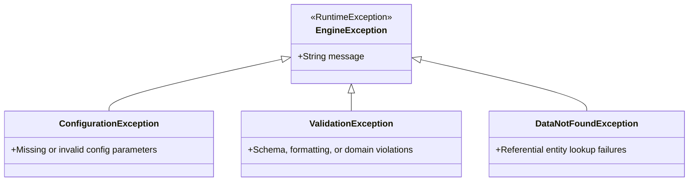

# ECE-035: Electronics Retail No-Cost EMI and Cashback Offer Engine
## Input & Command Layer Validation Specification

**Document Version:** 1.0.0  
**Project Identifier:** ECE-035 (Team E005)  
**Standard:** Strict Boundary & Schema Validation Specification  
**Authority:** Official Evaluator Data Pack (`E005-ECE-035-sample-data.zip`)  

---

## 1. Overview & Validation Philosophy

The input and command processing layer of the ECE-035 Offer Engine serves as the trusted gateway between raw external data feeds and the core domain calculation services. 

### Core Architectural Mandates:
1. **Decoupled Ingestion:** File I/O and CSV tokenization are strictly separated from domain business calculations. Loaders parse raw text into strongly typed, immutable domain models.
2. **Dynamic Configuration:** Zero hardcoded financial parameters. All operational thresholds, interest percentages, processing fees, and bundle rules are read dynamically from `offer_config.csv`.
3. **Exact Line-Number Traceability:** Every validation violation preserves the source file name and 1-based line number:  
   `[<filename> Line <lineNo>] <Specific Diagnostic Message>`
4. **Strict Command Sequencing:** `commands.txt` must be processed in file line order. Date-interleaved operations update in-memory state in chronological order.
5. **No Silent Swallowing:** Input anomalies are rejected with descriptive exceptions or handled according to formal business policies (e.g., blank tenure, unsupported tenure).

---

## 2. File Ingestion Schemas & Validation Contracts

### 2.1 `cards.csv` (Card Master Catalog)
- **File Name:** `cards.csv`
- **Expected Header:** `issuer_code,issuer_name,emi_eligible,cashback_eligible` (Exactly 4 columns)
- **Validation Invariants:**
  - **Header Integrity:** Mismatch in column count or names throws `ValidationException`.
  - **Column Count:** Every row must have exactly 4 comma-separated tokens.
  - **Primary Key Uniqueness:** `issuer_code` must be unique across the catalog (case-insensitive). Duplicate codes throw `ValidationException` citing the duplicate line and original line.
  - **Boolean Format:** `emi_eligible` and `cashback_eligible` must strictly evaluate to `"true"` or `"false"`. Any other string (e.g., `"yes"`, `"1"`, `""`) triggers a fatal `ValidationException`.

### 2.2 `offer_config.csv` (System Parameters)
- **File Name:** `offer_config.csv`
- **Expected Header:** `parameter,value` (Exactly 2 columns)
- **Validation Invariants:**
  - **Mandatory Key Coverage:** All 10 required parameter keys must be present:
    1. `EMI_MIN_BILL`
    2. `EMI_TENURES`
    3. `EMI_INTEREST_PA_PCT`
    4. `PROCESSING_FEE`
    5. `PROCESSING_FEE_WAIVED_FROM`
    6. `CASHBACK_PCT`
    7. `CASHBACK_CAP_PER_CARD_CUSTOMER_MONTH`
    8. `BUNDLE_TV_SOUNDBAR_OFF`
    9. `BUNDLE_PHONE_CASE_PCT_OFF_CASE`
    10. `RETURN_WINDOW_DAYS`
  - **Duplicate Prevention:** Declaring any parameter key more than once throws `ConfigurationException`.
  - **Numeric Precision:** All monetary amounts, thresholds, and percentages must parse as valid positive `BigDecimal` numbers.
  - **Tenure Parsing:** `EMI_TENURES` must be a semicolon-separated list of positive integers (`3;6;9`).
  - **Return Window:** `RETURN_WINDOW_DAYS` must parse as a non-negative integer ($\ge 0$).

### 2.3 `bills.csv` (Transaction Headers)
- **File Name:** `bills.csv`
- **Expected Header:** `bill_id,customer_id,bill_date,card_issuer,tenure_months` (Exactly 5 columns)
- **Validation Invariants:**
  - **Primary Key Format:** `bill_id` must match `^BILL-\d{4}$`. Duplicates throw `ValidationException`.
  - **Customer Identifier:** `customer_id` must match `^CUST-\d{3}$`.
  - **ISO-8601 Date:** `bill_date` must conform to standard `YYYY-MM-DD` and represent a valid calendar date.
  - **Issuer Presence:** `card_issuer` must be non-empty.
  - **Tenure Field Domain Policy:**
    - **Blank / Empty:** Customer did not request EMI (`tenureMonths = null`). Valid condition.
    - **Integer:** Customer requested financing (`tenureMonths = Integer`).
    - **Adversarial / Planted Values:** If an unsupported tenure is provided (e.g., tenure `12` in `BILL-0096`), it is parsed as integer `12` so the downstream EMI service can deterministically flag `emi_available = false` per TRAP-5.
    - **Non-Numeric Junk:** Alphanumeric tenure (e.g., `"abc"`) throws `ValidationException` with line number.

### 2.4 `bill_items.csv` (Transaction Line Items)
- **File Name:** `bill_items.csv`
- **Expected Header:** `bill_id,line_no,category,item_name,price` (Exactly 5 columns)
- **Validation Invariants:**
  - **Referential Integrity:** Every `bill_id` must exist in `bills.csv`. Orphaned line items throw `ValidationException`.
  - **Line Numbering:** `line_no` must be a positive integer ($\ge 1$). Duplicate `(bill_id, line_no)` pairs throw `ValidationException`.
  - **Category Taxonomy:** `category` must be one of the 12 recognized domain categories:
    `TV`, `SOUNDBAR`, `PHONE`, `CASE`, `LAPTOP`, `HEADPHONES`, `TABLET`, `AC`, `FRIDGE`, `SPEAKER`, `SMARTWATCH`, `MIXER`.
  - **Positive Pricing:** `price` must be a valid positive `BigDecimal` ($> 0.00$). Negative or zero prices throw `ValidationException`.
  - **Item Name:** `item_name` cannot be blank or whitespace-only.

### 2.5 `returns.csv` (Item Returns Ledger)
- **File Name:** `returns.csv`
- **Expected Header:** `return_id,bill_id,line_no,return_date` (Exactly 4 columns)
- **Validation Invariants:**
  - **Identifier Format:** `return_id` must match `^RET-\d{3}$`. Duplicates throw `ValidationException`.
  - **Referential Integrity (Bill):** `bill_id` must reference a valid existing bill in `bills.csv`.
  - **Referential Integrity (Item):** `line_no` must reference an existing item line belonging to `bill_id` in `bill_items.csv`.
  - **Chronological Sanity:** The return date must occur on or after the bill date:
    $$\text{return\_date} \ge \text{bill\_date}$$
    If $\text{return\_date} < \text{bill\_date}$, a `ValidationException` is raised.

---

## 3. Command Stream Architecture (`commands.txt`)

### 3.1 Command Syntax & Grammar
- **Syntax:** `COMMAND_NAME|arg1|arg2...`
- **Comment Lines:** Any line whose first non-whitespace character is `#` is ignored.
- **Blank Lines:** Empty or whitespace-only lines are ignored.
- **Token Delimiter:** Pipe character (`|`). Tokens are stripped of leading and trailing whitespace.

### 3.2 Supported Command Verbs & Argument Rules

| Command Verb | Required Arguments | Grammar & Semantic Contract | Validation Error Action |
|---|---|---|---|
| `LOAD_CONFIG` | 1 (`file_path`) | `LOAD_CONFIG\|<path>`: Ingests configuration key-values. | Throws `ValidationException` if missing path or file unreadable. |
| `LOAD_CARDS` | 1 (`file_path`) | `LOAD_CARDS\|<path>`: Ingests card issuers catalog. | Throws `ValidationException` if missing path or file unreadable. |
| `BILL` | 1 (`bill_id`) | `BILL\|<bill_id>`: Evaluates promotional options for that bill. | Validates `bill_id` syntax; throws `DataNotFoundException` if bill or line items missing. |
| `RETURN` | 1 (`return_id`) | `RETURN\|<return_id>`: Evaluates item return and cashback clawback. | Validates `return_id` syntax; throws `DataNotFoundException` if return or bill missing. |
| `PRINT_CASHBACK_REPORT` | 1 (`YYYY-MM`) | `PRINT_CASHBACK_REPORT\|<YYYY-MM>`: Emits monthly liability report. | Validates regex `^\d{4}-\d{2}$`; throws `ValidationException` on malformed month. |

### 3.3 Strict Sequential Execution Guarantee
`CommandProcessor` parses commands in linear file order. Transactions are processed synchronously:
1. `BILL` commands evaluate offers and update customer monthly cashback balances.
2. `RETURN` commands assess elapsed calendar days and claw back cashback if within 7 days.
3. `PRINT_CASHBACK_REPORT` aggregates the in-memory ledger for the requested month.

---

## 4. Summary of Exception Types & Diagnostics

All engine exceptions inherit from `EngineException`:

### Diagnostic Message Conventions:
- **Header Mismatch:** `[bills.csv Header Error] Expected 5 columns [bill_id, ...] but found [id, ...]`
- **Column Count:** `[cards.csv Line 5] Column count mismatch: Expected 4 columns but found 3`
- **Malformed ID:** `[bills.csv Line 12] Malformed bill_id 'B-01'. Expected format: BILL-nnnn`
- **Invalid Date:** `[returns.csv Line 8] Invalid date format '12-10-2026'. Expected ISO-8601 YYYY-MM-DD`
- **Duplicate Key:** `[cards.csv Line 7] Duplicate card issuer_code 'HDFC' (originally declared on line 2)`
- **Referential Integrity:** `[returns.csv Line 4] Referential integrity error: Return 'RET-001' references non-existent bill_id 'BILL-9999'`
- **Chronological Error:** `[returns.csv Line 6] Chronological anomaly: Return date (2026-09-30) is before bill date (2026-10-01)`

