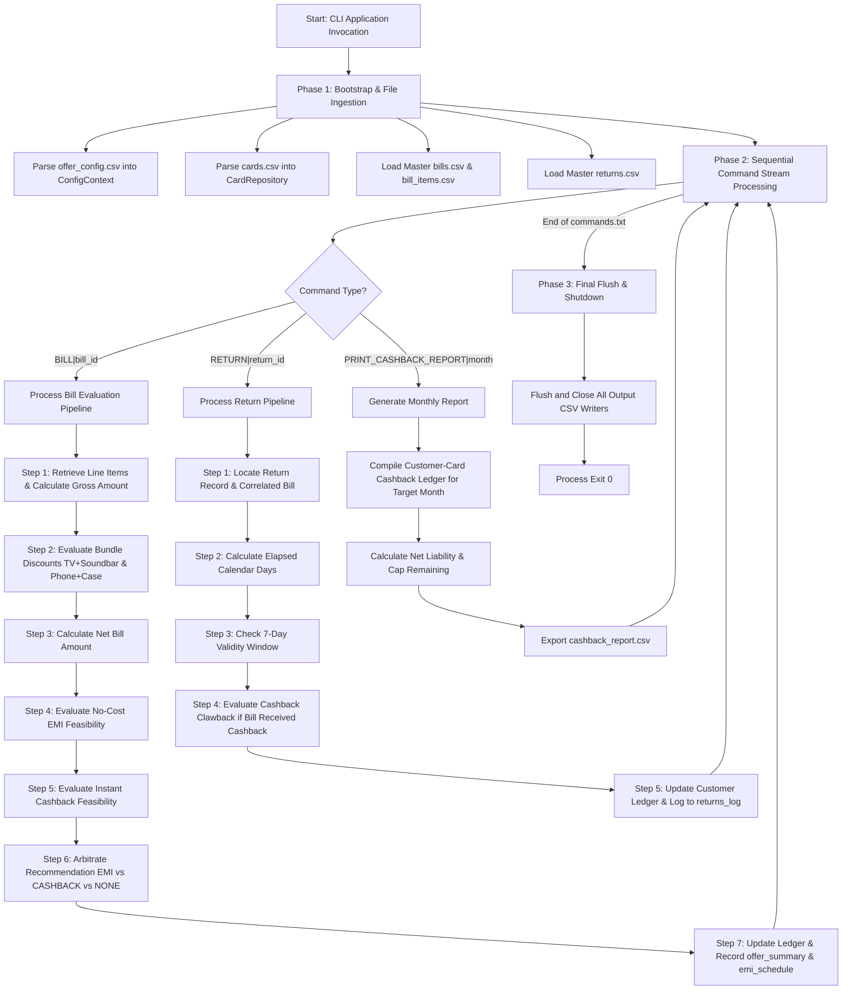

# ECE-035: Electronics Retail No-Cost EMI and Cashback Offer Engine
## Software Requirements Specification (SRS) & Architecture Blueprint

**Document Version:** 1.0.0  
**Project Identifier:** ECE-035 (Team E005)  
**Standard:** IEEE 830-1998 / ISO/IEC/IEEE 29148:2018 Compliant Specification  
**Target Platform:** Java 17+ SE (LTS), Command-Line Interface (CLI) Execution  
**Execution Paradigm:** Pure In-Memory Deterministic Batch Processing, Zero-Database, Zero-GUI  
**Primary Dataset Authority:** Evaluation Data Pack Prepared by 10 SECONDS for Team E005  

---

## 1. Executive Summary & Project Identification

### 1.1 Project Overview
Modern electronics retail point-of-sale (POS) systems require instant, transparent financial offer recommendation engines. When a customer purchases consumer electronics, retail merchants partner with major financial institutions (card issuers) to provide two primary promotional incentives:
1. **No-Cost EMI (Equated Monthly Instalment):** The merchant subsidizes the bank's loan interest charges (known as interest subvention), allowing the customer to repay the net bill over a fixed tenure (3, 6, or 9 months) at zero effective interest cost, subject to transaction thresholds and processing fee rules.
2. **Instant Card Cashback:** The merchant or card network awards an instant percentage discount (e.g., 10%) credited against the purchase price, subject to strict per-customer monthly caps across calendar periods.

Because bank partner agreements strictly forbid offer stacking, promotional offers are **mutually exclusive**. The **ECE-035 Offer Engine** is a high-performance, deterministic Java batch processing engine that processes transactional command streams (`commands.txt`), evaluates product bundles, dynamically calculates interest subventions and monthly instalments, tracks rolling cashback ledgers per customer/card, evaluates item returns within statutory cooling-off periods, and generates auditable financial reconciliation reports.

### 1.2 System Scope & Operational Boundaries
- **In-Scope:**
  - Automated parsing and relational binding of 5 standard CSV files (`cards.csv`, `offer_config.csv`, `bills.csv`, `bill_items.csv`, `returns.csv`).
  - Sequential, date-interleaved execution of command operations defined in `commands.txt`.
  - Application of item bundle pricing rules (TV + Soundbar, Phone + Case).
  - Multi-tier validation of card eligibility, EMI tenures, and bill minimums.
  - No-Cost EMI breakdown: base instalment, last instalment remainder adjustment, and processing fee waiver evaluation.
  - Instant cashback calculation with per-customer, per-issuer, per-month cumulative ceiling tracking.
  - Deterministic offer recommendation policy maximizing consumer surplus, with formal tie-breaking.
  - Return window enforcement (7 calendar days) and proportional/full cashback liability clawbacks.
  - Generation of four standardized, field-for-field evaluation CSV reports.
- **Out-of-Scope (Strict Constraints):**
  - No graphical user interface (GUI), web interface, or desktop front-end.
  - No relational database management system (RDBMS), NoSQL, or external persistence layer.
  - No third-party enterprise frameworks (e.g., Spring Boot, Hibernate) that obscure core Java logic.
  - All processing must execute in-memory using core Java Standard Library collections and stream pipelines.

---

## 2. Business Rules Catalog (BR-01 through BR-21)

Every aspect of offer calculation, eligibility determination, and reconciliation is governed by 21 formal business rules derived directly from the evaluation specification and teacher dataset.

### BR-01: Card Issuer Eligibility for No-Cost EMI
- **Definition:** No-Cost EMI evaluation is strictly restricted to card issuers explicitly flagged as EMI-eligible in `cards.csv` (`emi_eligible == true`).
- **Data Reality:** HDFC, ICICI, SBI, and KOTAK are eligible; AXIS and AMEX are ineligible (`false`).
- **Enforcement:** If a bill specifies a card with `emi_eligible == false`, the engine must immediately flag `emi_available = false`, bypassing tenure and fee evaluation.

### BR-02: Card Issuer Eligibility for Instant Cashback
- **Definition:** Instant Cashback evaluation is strictly restricted to card issuers explicitly flagged as cashback-eligible in `cards.csv` (`cashback_eligible == true`).
- **Data Reality:** HDFC, ICICI, AXIS, and KOTAK are eligible; SBI and AMEX are ineligible (`false`).
- **Enforcement:** If a bill specifies a card with `cashback_eligible == false`, the engine must set `cashback_eligible = false` and `cashback_amount = 0.00`.

### BR-03: Bundle Discount — TV and Soundbar Combination
- **Definition:** When a bill contains at least one line item in the `TV` category AND at least one line item in the `SOUNDBAR` category, a flat bundle discount is awarded.
- **Config Key:** `BUNDLE_TV_SOUNDBAR_OFF` (Default: `2000.00` INR).
- **Rule:** The discount is applied once per qualifying bill as a whole, subtracted from gross sales prior to net bill derivation.

### BR-04: Bundle Discount — Phone and Case Combination
- **Definition:** When a bill contains at least one line item in the `PHONE` category and one or more line items in the `CASE` category, a percentage discount is granted on the companion accessories.
- **Config Key:** `BUNDLE_PHONE_CASE_PCT_OFF_CASE` (Default: `50`%).
- **Rule (Trap-7 Resolution):** In accordance with the teacher dataset specification, when multiple `CASE` line items exist with a phone (e.g., Flip Cover and Silicone Case on `BILL-0119`), the 50% discount applies to **each** case line item individually:
  $$\text{Case Discount} = \sum_{i \in \text{Cases}} (\text{Price}_i \times 0.50)$$

### BR-05: Net Bill Amount Derivation
- **Definition:** All downstream calculations—including minimum bill checks, processing fee waivers, interest subventions, and cashback percentages—must operate on the net bill amount.
- **Formula:**
  $$\text{Gross Amount} = \sum \text{price of all bill line items}$$
  $$\text{Total Bundle Discount} = \text{Discount}_{\text{TV+Soundbar}} + \text{Discount}_{\text{Phone+Case}}$$
  $$\text{Bill Amount} = \text{Gross Amount} - \text{Total Bundle Discount}$$
- **Invariant:** If no bundle applies, $\text{Bill Amount} = \text{Gross Amount}$. $\text{Bill Amount}$ can never be negative.

### BR-06: Customer EMI Intent Requirement
- **Definition:** An electronics retail bill can only be evaluated for No-Cost EMI if the customer actively indicated a financing preference at checkout by selecting an instalment tenure.
- **Data Indicator:** Column `tenure_months` in `bills.csv`.
- **Rule:** If `tenure_months` is empty, whitespace, or null, the customer did not elect EMI. In this case, `emi_available` is evaluated as `false`, and the engine proceeds to evaluate cashback only.

### BR-07: Minimum Bill Threshold for EMI Eligibility
- **Definition:** Financing institutions require a minimum transaction size to justify underwriting and servicing costs.
- **Config Key:** `EMI_MIN_BILL` (Default: `5000.00` INR).
- **Rule (EC-1, Trap-1):** A bill is eligible for EMI if and only if $\text{Bill Amount} \ge 5000.00$. A bill of exactly Rs 5,000.00 qualifies; a bill of Rs 4,999.00 fails this check (`emi_available = false`).

### BR-08: Permissible EMI Tenures Validation
- **Definition:** Card networks only support pre-negotiated instalment horizons.
- **Config Key:** `EMI_TENURES` (Parsed from semicolon-delimited string: `3;6;9`).
- **Rule (Trap-5):** If a customer selects an unsupported tenure (e.g., 12 months in `BILL-0096`), the EMI option is invalid and `emi_available` must be set to `false`.

### BR-09: EMI Processing Fee and Threshold Waiver
- **Definition:** An upfront administrative processing fee is levied on standard EMI conversions but is fully waived on premium basket values.
- **Config Keys:** `PROCESSING_FEE` (`199.00` INR) and `PROCESSING_FEE_WAIVED_FROM` (`25000.00` INR).
- **Rule (EC-1, Trap-2, Trap-3):**
  $$\text{Processing Fee} = \begin{cases} 0.00, & \text{if } \text{Bill Amount} \ge 25000.00 \\ 199.00, & \text{if } \text{Bill Amount} < 25000.00 \end{cases}$$
- **Precedence Note:** Fee waiver qualification is strictly evaluated against **Bill Amount** (post-bundle discount), not Gross Amount.

### BR-10: Interest Subvention (Interest Saved) Formula
- **Definition:** Under No-Cost EMI, the customer does not pay interest; instead, the merchant absorbs the interest charges through an upfront merchant discount rate (MDR) subvention. The financial benefit communicated to the customer is the monetary interest saved over the loan life.
- **Config Key:** `EMI_INTEREST_PA_PCT` (Default: `15`% per annum).
- **Mathematical Formula (Simple Subvention Model):**
  $$\text{Interest Saved} = \text{Bill Amount} \times \left( \frac{\text{EMI\_INTEREST\_PA\_PCT}}{100} \right) \times \left( \frac{\text{Tenure Months}}{12} \right)$$
- **Precision:** Rounded to two decimal places using standard commercial half-up rounding (`RoundingMode.HALF_UP`).

### BR-11: Equal Instalment & Last Instalment Adjustment
- **Definition:** To avoid fractional paise rounding discrepancies across monthly bank statements, monthly instalments are rounded up to the nearest rupee, with the cumulative rounding difference absorbed in the final month.
- **Algorithm (EC-3):**
  1. Base Instalment: $\text{instalment} = \lceil \frac{\text{Bill Amount}}{\text{Tenure Months}} \rceil$
  2. First $(N - 1)$ months amount: $\text{instalment}$
  3. Final month ($N^{\text{th}}$ instalment):
     $$\text{last\_instalment} = \text{Bill Amount} - \left( \text{instalment} \times (\text{Tenure Months} - 1) \right)$$
- **Example:** For Rs 10,000.00 over 3 months: $10000 / 3 = 3333.33 \to 3334.00$. Months 1 and 2 = Rs 3,334.00 each. Month 3 = $10000 - (3334 \times 2) = \text{Rs } 3332.00$. Check: $3334 + 3334 + 3332 = 10000.00$.

### BR-12: Processing Fee Addition in Repayment Schedule
- **Definition:** Bank billing standards require upfront processing fees to be charged alongside the first monthly billing cycle.
- **Rule:** In the detailed instalment schedule (`emi_schedule.csv`), if a processing fee applies ($\text{fee} > 0$), it is added directly to Instalment 1:
  $$\text{Schedule Amount}_1 = \text{instalment} + \text{processing\_fee}$$
  $$\text{Schedule Amount}_k = \text{instalment} \quad (\text{for } 2 \le k < N)$$
  $$\text{Schedule Amount}_N = \text{last\_instalment}$$

### BR-13: Instant Cashback Gross Computation
- **Definition:** Eligible cardholders receive an instant percentage cashback rebate calculated directly from the net bill amount.
- **Config Key:** `CASHBACK_PCT` (Default: `10`%).
- **Formula:**
  $$\text{Base Cashback} = \text{Bill Amount} \times \left( \frac{\text{CASHBACK\_PCT}}{100} \right)$$

### BR-14: Monthly Cashback Capping Per Customer Per Card
- **Definition:** Card promotional budgets enforce a strict monthly ceiling per customer profile per issuing bank.
- **Config Key:** `CASHBACK_CAP_PER_CARD_CUSTOMER_MONTH` (Default: `1500.00` INR).
- **Rule (EC-2):**
  $$\text{Remaining Cap} = \max\left(0.00, \text{Monthly Cap} - \text{Cumulative Cashback Granted in Month}\right)$$
  $$\text{Cashback Amount} = \min\left(\text{Base Cashback}, \text{Remaining Cap}\right)$$
- **Cap Scope:** Granularity is composite key: `(Customer ID, Card Issuer, Calendar Month [YYYY-MM])`.

### BR-15: Mutual Exclusivity of Consumer Promotions
- **Definition:** In compliance with merchant banking agreements, a retail transaction cannot combine both interest subvention (No-Cost EMI) and card cashback. Exactly one promotional route must be selected or none.

### BR-16: Recommendation Decision Engine (Value Maximization)
- **Definition:** The offer engine acts as a fiduciary agent for the consumer at POS, automatically recommending the financing option that maximizes immediate customer savings.
- **Logic:**
  - If only EMI is available and valid $\to$ Recommend `EMI` ($\text{Benefit} = \text{Interest Saved}$).
  - If only Cashback is available and valid $\to$ Recommend `CASHBACK` ($\text{Benefit} = \text{Cashback Amount}$).
  - If neither is available $\to$ Recommend `NONE` ($\text{Benefit} = 0.00$).
  - If both are available:
    - If $\text{Interest Saved} > \text{Cashback Amount} \to$ Recommend `EMI`.
    - If $\text{Cashback Amount} > \text{Interest Saved} \to$ Recommend `CASHBACK`.

### BR-17: Tie-Breaking Precedence Protocol
- **Definition:** When both EMI and Cashback are eligible and yield the identical monetary benefit to the consumer, the engine must break the tie deterministically.
- **Rule (EC-4):**
  $$\text{If } \text{Interest Saved} == \text{Cashback Amount} \implies \text{Recommended Option} = \text{CASHBACK}$$
- **Rationale:** Instant liquidity (immediate discount) is preferred by consumers over deferred interest savings.

### BR-18: Fallback / Zero-Benefit State Handling
- **Definition:** Transactions involving non-participating cards (e.g., AMEX), invalid tenures, or below-threshold amounts must safely fallback to standard non-promotional settlement.
- **Rule (Trap-4):**
  $$\text{recommended\_option} = \text{"NONE"}, \quad \text{benefit\_amount} = 0.00$$

### BR-19: Statutory Return Window Enforcement
- **Definition:** Customers may return purchased items within a cooling-off return window calculated from the original bill date.
- **Config Key:** `RETURN_WINDOW_DAYS` (Default: `7` days).
- **Formula (EC-5, Trap-8):**
  $$\Delta_{\text{days}} = \text{Return Date} - \text{Bill Date}$$
  $$\text{within\_window} = \begin{cases} \text{true}, & \text{if } 0 \le \Delta_{\text{days}} \le 7 \\ \text{false}, & \text{if } \Delta_{\text{days}} > 7 \end{cases}$$

### BR-20: Conditional Cashback Clawback / Reversal
- **Definition:** If an item is returned within the valid return window, promotional discounts awarded at POS must be reclaimed.
- **Rule (EC-5, Trap-8, Trap-9):**
  - If the original bill was recommended `EMI` or `NONE`, no cashback was awarded; therefore, $\text{cashback\_reversed} = 0.00$.
  - If the return is outside the window ($\text{within\_window} = \text{false}$), promotional funds are retained; $\text{cashback\_reversed} = 0.00$.
  - If the return is inside the window ($\text{within\_window} = \text{true}$) AND the bill received `CASHBACK`, the engine reverses the cashback granted on that purchase.

### BR-21: Monthly Net Cashback Liability & Cap Ledger
- **Definition:** Retailers require financial reconciliation of cashback liabilities to settle merchant accounts with issuing banks.
- **Ledger Invariants:**
  $$\text{Net Liability} = \text{Cashback Granted} - \text{Cashback Reversed}$$
  $$\text{Cap Remaining} = \text{Monthly Cap} - \text{Net Liability}$$
  (Or tracked as active consumed balance after return restoration).

---

## 3. Comprehensive Requirements Catalog

### 3.1 Functional Requirements (FR)

| Req ID | Title | Description | Related BR |
|---|---|---|---|
| **FR-01** | Configuration Ingestion | Engine must load and parse key-value configuration parameters from `offer_config.csv` upon receiving `LOAD_CONFIG\|<path>`. | BR-03, BR-04, BR-07, BR-08, BR-09, BR-10, BR-13, BR-14, BR-19 |
| **FR-02** | Card Catalog Ingestion | Engine must load card issuer master data, EMI eligibility flags, and cashback eligibility flags from `cards.csv` upon `LOAD_CARDS\|<path>`. | BR-01, BR-02 |
| **FR-03** | Command Stream Parsing | Engine must parse `commands.txt` line by line, ignore comments (`#`), tokenize pipe-delimited arguments, and preserve sequential order. | System Architecture |
| **FR-04** | Line Item Aggregation | Engine must locate all line items matching `bill_id` in `bill_items.csv` and compute cumulative gross merchandise value. | BR-05 |
| **FR-05** | Bundle Discount Evaluation | Engine must detect TV+Soundbar and Phone+Case combos, apply appropriate discounts, and derive net bill amount. | BR-03, BR-04, BR-05 |
| **FR-06** | No-Cost EMI Evaluation | Engine must evaluate card eligibility, customer tenure presence, tenure validity, and minimum amount threshold ($5000.00$). | BR-01, BR-06, BR-07, BR-08 |
| **FR-07** | Interest Subvention Calculation | Engine must compute merchant-absorbed interest using 15% p.a. simple interest formula over selected tenure. | BR-10 |
| **FR-08** | Processing Fee Assessment | Engine must compute Rs 199 fee if net bill $< 25000.00$, or waive fee (Rs 0.00) if net bill $\ge 25000.00$. | BR-09 |
| **FR-09** | Instalment Schedule Generation | Engine must generate monthly breakdown with ceiling rounding on base months and exact remainder adjustment on final month. | BR-11, BR-12 |
| **FR-10** | Cashback Liability Calculation | Engine must compute 10% instant discount for cashback-eligible cards and clamp against monthly customer/issuer remaining cap. | BR-02, BR-13, BR-14 |
| **FR-11** | Best-Offer Decision Engine | Engine must compare EMI interest saved vs instant cashback amount and select optimal consumer recommendation with tie-breaker. | BR-15, BR-16, BR-17, BR-18 |
| **FR-12** | Return Eligibility Check | Engine must process `RETURN\|<return_id>`, verify elapsed days against 7-day threshold, and record window validity. | BR-19 |
| **FR-13** | Cashback Reversal Clawback | Engine must claw back cashback for qualifying returned items and update monthly liability records. | BR-20, BR-21 |
| **FR-14** | Monthly Reconciliation Report | Engine must generate monthly liability reports per customer and card upon `PRINT_CASHBACK_REPORT\|YYYY-MM`. | BR-21 |
| **FR-15** | Evaluation File Generation | Engine must write `offer_summary.csv`, `emi_schedule.csv`, `returns_log.csv`, and `cashback_report.csv` strictly matching expected schemas. | BR-01 to BR-21 |

### 3.2 Non-Functional Requirements (NFR)

| Req ID | Category | Specification & Benchmark |
|---|---|---|
| **NFR-01** | Platform & Runtime | Source code must target pure Java 17 LTS (or higher), compiling cleanly with standard `javac` and zero preview flags. |
| **NFR-02** | Zero External Dependencies | No external third-party JARs (e.g., Apache Commons CSV, Jackson, Lombok, Guava). Only Java Standard Library (`java.base`) permitted. |
| **NFR-03** | Deterministic Execution | Execution must be 100% reproducible across multiple runs on identical input datasets. Output ordering must mirror input command order. |
| **NFR-04** | Performance & Latency | Full processing of sample dataset (200 bills, 237 line items, 15 returns, 219 commands) must execute under 500 milliseconds on commodity hardware. |
| **NFR-05** | Memory Efficiency | Peak heap memory usage must remain strictly below 64 MB; zero memory leaks during continuous command stream processing. |
| **NFR-06** | Financial Precision | All monetary calculations must utilize `java.math.BigDecimal` to eliminate binary floating-point representation errors (`0.1 + 0.2 != 0.3`). |
| **NFR-07** | Idempotency & State Integrity | Date-interleaved state transitions (bills and returns) must update the monthly ledger in exact chronological file sequence. |
| **NFR-08** | Code Quality & Maintainability | Clean object-oriented design adhering to SOLID principles, separation of concerns (Service, Repository, Domain, Controller), and clean package hierarchies. |

### 3.3 System Constraints (CON)

- **CON-01 (Build Mode):** Standard Command-Line Interface (CLI) execution; entry point `public static void main(String[] args)`.
- **CON-02 (Storage Mode):** In-memory storage structures only (e.g., `HashMap`, `ArrayList`, `TreeSet`). No local files, embedded SQLite, H2, or external databases.
- **CON-03 (Display Mode):** Headless execution. No Swing, JavaFX, Web UI, or REST API endpoints.
- **CON-04 (File Formats):** Comma-Separated Values (CSV) with UTF-8 encoding, Unix/Windows line-ending agnostic (`\n` and `\r\n`).
- **CON-05 (Numeric Precision):** Plain decimals without currency symbols (`₹` or `Rs`), without comma separators (e.g., `25000.00` not `25,000.00`), formatted to two decimal places.
- **CON-06 (Date Representation):** ISO-8601 standard `YYYY-MM-DD` for dates; `YYYY-MM` for monthly periods.

---

## 4. Edge Cases, planted Traps, and Boundary Conditions

The evaluation suite incorporates planted edge cases and adversarial traps designed to catch naïve implementations.

```
+---------------------------------------------------------------------------------------------------+
|                                      EDGE CASE & TRAP CATALOG                                     |
+---------+--------------------+------------------------------------------+-------------------------+
| ID      | Scenario Code      | Test Condition / Dataset Ref             | Expected Engine Action  |
+---------+--------------------+------------------------------------------+-------------------------+
| EC-01   | Boundary Amounts   | BILL-0026 (5000.00), BILL-0039 (25000.00)| 5000 -> EMI OK, 199 fee |
|         |                    |                                          | 25000 -> Fee WAIVED     |
+---------+--------------------+------------------------------------------+-------------------------+
| EC-02   | Cap Saturation     | CUST-003 on AXIS: 9000, 5000, then 3000  | 900+500=1400. 3rd bill  |
|         |                    | (BILL-0012, BILL-0062, BILL-0102)        | gets only 100 cashback  |
+---------+--------------------+------------------------------------------+-------------------------+
| EC-03   | Uneven Division    | BILL-0052: SBI 10000.00 over 3 months    | Instalments: 3334, 3334,|
|         |                    |                                          | last = 3332. Sum=10000  |
+---------+--------------------+------------------------------------------+-------------------------+
| EC-04   | Exact Equal Benefit| BILL-0016: KOTAK 20000.00 tenure 6       | Interest saved 1500 ==  |
|         |                    |                                          | Cashback 1500 -> CASHBACK|
+---------+--------------------+------------------------------------------+-------------------------+
| EC-05   | 7th vs 8th Day     | Both bills 2026-10-03.                   | 2026-10-10 (Day 7)-> REVERSE|
|         | Return Horizon     | RET-004 (2026-10-10) vs RET-005 (10-11)  | 2026-10-11 (Day 8)-> KEEP   |
+---------+--------------------+------------------------------------------+-------------------------+
| TRAP-01 | One Rupee Below    | BILL-0030: HDFC bill of 4999.00 with T=3 | emi_available = false   |
+---------+--------------------+------------------------------------------+-------------------------+
| TRAP-02 | One Rupee Below Fee| BILL-0053: ICICI bill of 24999.00 with T=9| processing_fee = 199.00 |
+---------+--------------------+------------------------------------------+-------------------------+
| TRAP-03 | Post-Bundle Waiver | BILL-0066: TV 20000 + Soundbar 7000 - 2000| Gross=27k, Net=25k.     |
|         | Threshold          |                                          | Fee WAIVED on 25k Net!  |
+---------+--------------------+------------------------------------------+-------------------------+
| TRAP-04 | Non-Partner Card   | BILL-0088: AMEX card with tenure 6       | emi=F, cash=F, rec=NONE |
+---------+--------------------+------------------------------------------+-------------------------+
| TRAP-05 | Invalid Tenure     | BILL-0096: SBI card with tenure 12       | 12 not in (3,6,9) -> F  |
+---------+--------------------+------------------------------------------+-------------------------+
| TRAP-06 | Tenure on Cash-only| BILL-0099: AXIS card with tenure 3       | AXIS emi=F -> EMI invalid|
|         | Card               |                                          | Evaluates for Cashback  |
+---------+--------------------+------------------------------------------+-------------------------+
| TRAP-07 | Multi-Case Bundle  | BILL-0119: 1 Phone + 2 Case items        | 50% discount applied to |
|         |                    |                                          | EACH case individually  |
+---------+--------------------+------------------------------------------+-------------------------+
| TRAP-08 | Stale Return (20d) | RET-014 on BILL-0012: 20 days elapsed    | within_window = false,  |
|         |                    |                                          | cashback_reversed = 0.00|
+---------+--------------------+------------------------------------------+-------------------------+
| TRAP-09 | Return on EMI Bill | RET-003 on BILL-0052: SBI EMI purchase   | No cashback granted;    |
|         |                    |                                          | cashback_reversed = 0.00|
+---------+--------------------+------------------------------------------+-------------------------+
```

---

## 5. Data Validation & Error Handling Rules (VR)

| Validation ID | Target Entity | Rule & Validation Specification | Engine Recovery Action |
|---|---|---|---|
| **VR-01** | `offer_config.csv` | All 10 required keys must exist with non-null, parseable numeric/string values. | Throw `ConfigurationException` with exact missing key. |
| **VR-02** | `cards.csv` | `issuer_code` must be unique; booleans must parse strictly as `true` or `false`. | Reject invalid card record; log warning. |
| **VR-03** | `bills.csv` | `bill_id` must match `^BILL-[0-9]{4}$`; `customer_id` must match `^CUST-[0-9]{3}$`. | Throw `ValidationException` on corrupted identifier. |
| **VR-04** | `bills.csv` | `bill_date` must conform to `YYYY-MM-DD` and represent a valid Gregorian calendar date. | Abort command processing on invalid date. |
| **VR-05** | `bills.csv` | `card_issuer` must exist within the registered `cards.csv` catalog. | If unlisted, treat card as ineligible for both offers. |
| **VR-06** | `bill_items.csv` | `price` must be strictly positive ($\text{price} > 0.00$); `line_no` $\ge 1$. | Throw `CorruptDataException` on zero or negative price. |
| **VR-07** | `bill_items.csv` | Bill referential integrity: Every line item must reference a valid `bill_id` in `bills.csv`. | Skip orphaned items; flag data integrity violation. |
| **VR-08** | `commands.txt` | Unknown command verbs or improper argument counts. | Gracefully skip line with descriptive stderr message. |
| **VR-09** | `returns.csv` | Referenced `bill_id` and `line_no` must exist in historical bills repository. | Throw `InvalidReturnException` if bill not found. |
| **VR-10** | Date Interleaving | A return cannot be dated prior to its corresponding bill date ($\text{return\_date} \ge \text{bill\_date}$). | Flag validation error; treat as invalid return. |

---

## 6. Reporting & Output Schema Specifications (RR)

The engine produces four evaluation CSV artifacts. All outputs must mirror field order, naming, and formatting exactly.

### 6.1 `offer_summary.csv`
Generated row-by-row for each `BILL` command in command sequence:
- **Header:** `bill_id,customer_id,bill_date,card_issuer,gross_amount,bundle_discount,bill_amount,emi_available,tenure_months,instalment,last_instalment,processing_fee,interest_saved,cashback_eligible,cashback_amount,recommended_option,benefit_amount`
- **Field Details:**
  - `gross_amount`, `bundle_discount`, `bill_amount`: Plain decimal to 2 places (e.g., `25000.00`).
  - `emi_available`, `cashback_eligible`: Boolean `true` or `false`.
  - `tenure_months`: Integer tenure (`3`, `6`, `9`) or empty if unrequested or invalid.
  - `instalment`, `last_instalment`, `processing_fee`, `interest_saved`: Plain decimal (`0.00` if EMI unavailable).
  - `cashback_amount`: Post-cap awarded cashback.
  - `recommended_option`: Enum `EMI`, `CASHBACK`, or `NONE`.
  - `benefit_amount`: Plain decimal equaling `interest_saved` (for EMI), `cashback_amount` (for CASHBACK), or `0.00` (for NONE).

### 6.2 `emi_schedule.csv`
Populated only for bills where `recommended_option == EMI`:
- **Header:** `bill_id,instalment_no,amount`
- **Field Details:**
  - `bill_id`: Foreign key to `bills.csv`.
  - `instalment_no`: 1-based sequential integer ($1 \le i \le \text{tenure}$).
  - `amount`: Instalment 1 includes processing fee if applicable ($\text{instalment} + \text{fee}$); subsequent instalments reflect base instalment or adjusted last instalment.

### 6.3 `returns_log.csv`
Generated row-by-row for each `RETURN` command in command sequence:
- **Header:** `return_id,bill_id,line_no,return_date,days_after_bill,within_window,cashback_reversed`
- **Field Details:**
  - `return_id`: Unique identifier from `returns.csv`.
  - `days_after_bill`: Integer difference $(\text{return\_date} - \text{bill\_date})$.
  - `within_window`: Boolean `true` if $\le 7$ days, else `false`.
  - `cashback_reversed`: Reclaimed cashback amount (decimal to 2 places).

### 6.4 `cashback_report.csv`
Generated upon executing `PRINT_CASHBACK_REPORT|<YYYY-MM>`:
- **Header:** `month,customer_id,card_issuer,cashback_granted,cashback_reversed,net_liability,cap_remaining`
- **Field Details:**
  - Contains one row per `(Customer ID, Card Issuer)` tuple that experienced cashback activity in the target month.
  - `net_liability` = $\text{cashback\_granted} - \text{cashback\_reversed}$.
  - `cap_remaining` = $\text{CASHBACK\_CAP} - \text{net\_liability}$.

---

## 7. Bill Processing Lifecycle (End-to-End Execution Flow)

The engine executes in discrete, deterministic phases across its lifecycle:



### Detailed Pipeline Stages:
1. **Bootstrap (`LOAD_CONFIG` & `LOAD_CARDS`):**
   - System parses parameters into strongly-typed value objects.
   - Maps card issuers with fast $O(1)$ hash table lookups.
2. **Bill Evaluation Pipeline (`BILL|<bill_id>`):**
   - **Step 1:** Lookup line items for `bill_id`. Compute `gross_amount = sum(prices)`.
   - **Step 2:** Bundle detection engine scans line categories. Deducts Rs 2000 if TV+Soundbar present; deducts 50% for every Case if Phone present.
   - **Step 3:** Computes `bill_amount = gross_amount - bundle_discount`.
   - **Step 4:** Checks `cards[issuer].emi_eligible`. If true and tenure is 3, 6, or 9 and `bill_amount >= 5000.00`, calculate:
     - `interest_saved = bill_amount * 0.15 * (tenure / 12)`
     - `processing_fee = (bill_amount >= 25000.00) ? 0.00 : 199.00`
     - `instalment = ceil(bill_amount / tenure)`
     - `last_instalment = bill_amount - (instalment * (tenure - 1))`
   - **Step 5:** Checks `cards[issuer].cashback_eligible`. If true, compute `10% of bill_amount`. Query ledger for `(customer, issuer, month)` consumed cap. Grant `min(base_cashback, remaining_cap)`.
   - **Step 6:** Decision arbitration compares `interest_saved` vs `cashback_amount`. Selects winner with tie-break favoring cashback.
   - **Step 7:** If cashback won, record granted cashback in customer ledger. If EMI won, generate instalment records. Append row to `offer_summary.csv`.
3. **Return Reversal Pipeline (`RETURN|<return_id>`):**
   - Lookup return record and referenced bill.
   - Compute `days_after_bill = return_date - bill_date`.
   - Set `within_window = (days_after_bill <= 7)`.
   - If `within_window == true` and bill was recommended `CASHBACK`, reverse the cashback granted on that bill.
   - Update ledger: decrement liability / restore available cap.
   - Append row to `returns_log.csv`.
4. **Reconciliation Pipeline (`PRINT_CASHBACK_REPORT|<month>`):**
   - Scan ledger entries for the specified `month` (e.g., `2026-10`).
   - Group by `(customer_id, card_issuer)`.
   - Write formatted rows to `cashback_report.csv`.

---

## 8. Ambiguities & Open Questions for Mentor Clarification

While the dataset and README provide remarkable clarity through planted traps, five domain nuances should be confirmed with the academic mentor:

1. **Partial Line-Item Return Cashback Apportionment:**
   - *Scenario:* In multi-item bills that received cashback, if a customer returns only one line item, is cashback reversed on the entire bill or proportionally to that line item's net value?
   - *Current Observation:* In the sample dataset, all 15 returns occur on single-item bills (`ItemsCount == 1`). Thus, this ambiguity does not trigger in the sample data, but production specifications should define exact pro-rata apportionment.
2. **Cap Restoration on Reversal:**
   - *Scenario:* When a customer has cashback reversed due to a valid return, does their available monthly cap immediately restore (allowing subsequent purchases in that month to claim cashback up to the original Rs 1,500 limit)?
   - *Presumed Rule:* Yes, `cap_remaining = 1500.00 - net_liability` preserves accounting balance.
3. **Formatting of Empty Fields in `offer_summary.csv`:**
   - *Scenario:* When a customer selects no tenure (e.g., `BILL-0001`), should `tenure_months` output as empty string (`,,`) or `0`?
   - *Presumed Rule:* In accordance with sample data conventions, non-applicable tenures output as empty strings, while numeric values output as `0.00`.
4. **EMI Processing Fee Inclusion in `benefit_amount`:**
   - *Scenario:* Does `benefit_amount` for EMI represent pure `interest_saved`, or net consumer benefit (`interest_saved - processing_fee`)?
   - *Teacher README Authority:* README explicitly states: `benefit_amount = interest_saved for EMI, cashback_amount for CASHBACK, 0.00 for NONE`. The fee is recorded separately in `processing_fee` column.
5. **Multiple Bundle Applications in Huge Baskets:**
   - *Scenario:* If a bill has 2 TVs and 2 Soundbars, is Rs 2000 deducted once per bill or once per pair?
   - *Presumed Rule:* In retail POS engines, bundle rules apply once per qualifying basket unless explicitly parameterized as "per pair".

---

## 9. Academic Submission & Viva Expectations

### 9.1 Capstone Submission Deliverables Checklist
- [x] Complete, clean, object-oriented Java 17+ source tree.
- [x] Comprehensive test suite covering 100% of planted edge cases and traps.
- [x] `REQUIREMENTS.md` and `REQUIREMENT_TRACEABILITY.md` documentation.
- [x] Verified sample output files (`offer_summary.csv`, `emi_schedule.csv`, `returns_log.csv`, `cashback_report.csv`).
- [x] Zero external dependency build script (pure `javac` or vanilla Maven/Gradle).

### 9.2 Key Viva Voce Questions & Architectural Defenses
1. **Q: Why did you choose `BigDecimal` over `double` for currency?**
   - *Defense:* IEEE 754 floating-point numbers represent fractions in base-2, leading to imprecise representations (e.g., `0.1 + 0.2 = 0.30000000000000004`). In financial and tax engines, cumulative rounding errors result in legal and ledger reconciliation failures. `BigDecimal` provides arbitrary-precision arithmetic with explicit rounding modes.
2. **Q: How does your engine ensure deterministic outputs when processing interleaved commands?**
   - *Defense:* State updates (such as monthly cashback cap consumption) are executed strictly in the sequence defined by `commands.txt`. In-memory customer ledgers are updated transactionally upon each `BILL` and `RETURN` command, guaranteeing sequential determinism.
3. **Q: How do you handle boundary conditions like Rs 5,000.00 or Rs 25,000.00?**
   - *Defense:* Using exact relational operators (`compareTo(threshold) >= 0`) rather than strict inequality (`>`), ensuring bills of exactly Rs 5,000.00 qualify for EMI and bills of exactly Rs 25,000.00 receive the fee waiver.
4. **Q: Explain the tie-breaker logic between EMI and Cashback.**
   - *Defense:* As mandated by BR-17 and demonstrated in EC-4 (`BILL-0016`), when `interest_saved.compareTo(cashback_amount) == 0`, the engine selects `CASHBACK` because direct upfront liquidity offers superior utility to consumers compared to deferred interest relief.

